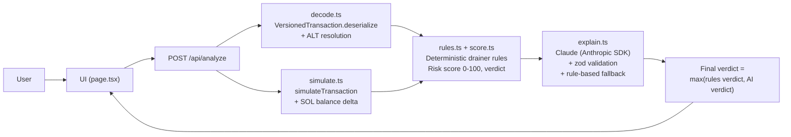

# Architecture

## Flow

## Data flow

1. The UI collects a base64 transaction: a demo builder (`demoTx.ts`), a pasted string, or a connected wallet's transaction.
2. `/api/analyze` decodes every instruction (System Program, SPL Token, Token-2022, Associated Token, Compute Budget, Memo, Jupiter v6, Stake; anything else is `Unknown`).
3. The transaction is simulated on devnet (`simulateTransaction`, `sigVerify: false`, `replaceRecentBlockhash: true`). Simulation failure is not fatal — the analysis continues with static analysis only and says so in the UI.
4. The deterministic rules engine scores the decoded instructions and the simulation (balance delta, transfers). This produces the findings, the risk score, and the rules verdict.
5. Claude explains the result in plain English (6th-grade reading level) and returns a verdict. If the key is missing or the call fails, a template explanation built from the rule findings is used instead (`aiUsed: false`).
6. The final verdict is the more severe of the rules verdict and the AI verdict, so the AI can never downgrade a critical finding. The risk score always comes from the rules engine.

## Key files

- `src/lib/types.ts` — shared types (`Analysis`, `Finding`, `DecodedInstruction`, `SimulationSummary`)
- `src/lib/solana/decode.ts` — base64 → decoded instructions
- `src/lib/solana/simulate.ts` — devnet simulation + SOL delta
- `src/lib/solana/demoTx.ts` — the 3 demo transactions (unsigned, never sent)
- `src/lib/risk/rules.ts`, `src/lib/risk/score.ts` — drainer rules and scoring
- `src/lib/ai/prompt.ts`, `src/lib/ai/explain.ts` — Claude prompts, validation, fallback
- `src/app/api/analyze/route.ts` — the single API route
- `src/app/page.tsx` + `src/components/*` — single-page dark UI
